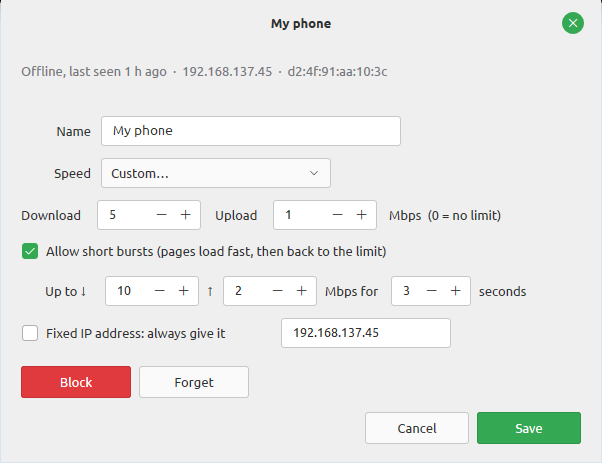
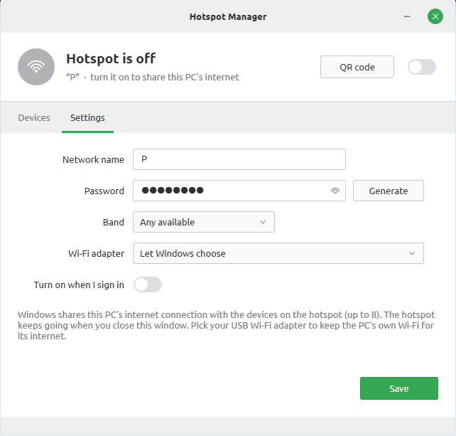
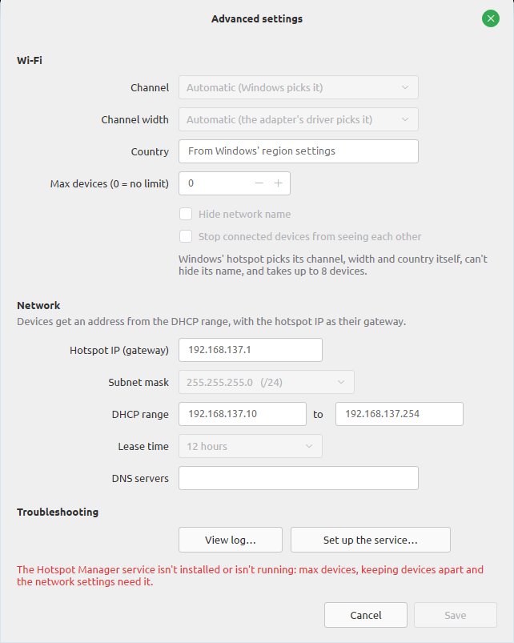

# hotspot-manager-linux

A desktop app for running a **fast 5 GHz Wi-Fi hotspot** on Linux from a second Wi-Fi adapter
(for example a USB dongle), with full control from one window:

- **On/off switch**, and an option to turn it on at startup
- **Name, password, band (5 / 2.4 GHz), channel, channel width (20 / 40 / 80 MHz)**, country,
  hidden network, max devices, and isolating devices from each other
- **Devices**: every device that's connected (or has been), with its name, maker, IP, MAC, signal,
  **live speed it's using right now**, data used and time connected. Search them, sort by any column, and
  give them names you'll recognise
- **Speed limits**: per device, for **all devices** at once, and/or a **total** for the whole hotspot, separately
  for download and upload. Devices are remembered by MAC address, so a limit sticks when they reconnect
- **Network**: hotspot IP (the gateway devices get), subnet mask, DHCP range, lease time and DNS servers, plus a
  **fixed IP per device**. Clashes with your other networks are refused before anything changes
- **Click a device** to rename it, change its speed or IP, or disconnect, block or forget it
- **QR code** button: a code your phone camera can scan to join, plus the name and password
- **Log** tab, so you can see why it failed to start

## Windows

There's a Windows version too, in [`windows/`](windows): a native app (Rust, ~3 MB) on Windows' own
**Mobile hotspot**, with the same controls as the Linux app and the look of Linux Mint. It can put the hotspot on
the adapter you pick, so a **USB Wi-Fi dongle hosts it** while the PC's own Wi-Fi keeps its internet connection.

| A device | Settings | Advanced |
|---|---|---|
|  |  |  |

As on Linux:

- **On/off switch**, the hotspot's state, its devices and its live speed, and a **QR code** to join
- **Works without internet too**: Windows' own hotspot only starts with a connection to share; with none, the
  switch starts a local-only hotspot (Windows' Wi-Fi Direct as a normal access point, as MyPublicWiFi does), so
  phones and laptops can still reach each other and this PC (local games, sharing files)
- **Name, password** (show it, or generate one), **band** (5 / 2.4 GHz), **which Wi-Fi adapter** hosts it, and
  **turn on automatically** when you sign in
- **Devices**: connected now (and offline ones, if you like), with their name, maker, IP, MAC, **live speed**,
  **speed limit** and **data used**; search them and sort by any column. Click one to rename it, give it its own
  speed or a **fixed IP**, or to **disconnect**, **block** or **forget** it
- **Speed for everyone** (each device its own lane), **custom speeds with bursts**, and a **cap for the whole
  hotspot**
- **Advanced**: max devices, keeping devices from seeing each other, the **hotspot IP**, **DHCP range**, **lease
  time** and **DNS servers**, and the **log**

Windows decides a few things itself, so they're shown but greyed: the channel and channel width (the adapter's
driver picks them), the country (Windows' region), hiding the network name (Windows can't), and the subnet mask
(always /24). It takes up to 8 devices. "Disconnect" stops a device's connection for a minute, since Windows
can't push a device off its hotspot.

How it works: the window uses Windows' hotspot API, as the Settings app does. What needs administrator rights
is done by a small **helper service** (`HotspotManager`), as `hotspotctl` does on Linux: speed limits (token
buckets per device, like the Linux `tc` setup), blocking and data used go through
[WinDivert](https://reqrypt.org/windivert.html), a signed open-source packet driver; when you change the DHCP
range, lease time, DNS servers or give a device a fixed IP, the helper answers the devices' DHCP requests
itself; and it sets the hotspot's IP. Signed-in users talk to it through a named pipe; it checks everything it's
given. Its log is in `%ProgramData%\Hotspot Manager`.

**Install** (Windows 10 2004 or later): with [Rust](https://rustup.rs) installed,

```powershell
git clone https://github.com/xsobhi/hotspot-manager-linux
cd hotspot-manager-linux
powershell -ExecutionPolicy Bypass -File windows\install.ps1
```

That builds it, asks for administrator rights once, and installs it in `C:\Program Files\Hotspot Manager` with
the helper service and WinDivert, in the Start menu and on the desktop (`windows\install.ps1 -Uninstall`
removes it all). **Microsoft Defender often flags WinDivert** as potentially unwanted, because malware uses
packet drivers too: run the installer with `-AllowWinDivert` to ask Defender to leave just the program's
folder alone (`-Uninstall` takes that back). Without it, everything but speed limits, blocking and data used works.
`hotspot-manager --turn-on` turns the hotspot on without a window.

## Why not NetworkManager's built-in hotspot?

NetworkManager (≤ 1.50) always starts its hotspot at **20 MHz** width. On 5 GHz that caps a phone's
link at about 78–87 Mbit/s, which is roughly 30–50 Mbit/s in a speed test. This app runs
[hostapd](https://w1.fi/hostapd/) directly at **80 MHz** instead, which allows up to 433 Mbit/s per
spatial stream.

It's a thin layer over standard tools:

| Part | Does |
|---|---|
| `hostapd` | runs the access point (WPA2, 802.11n/ac) |
| `dnsmasq` | gives devices addresses (default `10.42.0.0/24`), fixed IPs, and forwards DNS |
| `iptables` | NAT to whatever connection the laptop is using, plus rules that work with ufw on |
| `tc` (HTB + fq_codel, IFB for upload) | speed limits |
| `hotspotctl` | small root helper that ties it together, run as the `hotspot-manager` systemd service |
| `hotspot-manager` | the GTK 3 window |

While the hotspot is on, NetworkManager is told to leave that one adapter alone. Your normal Wi-Fi
or Ethernet keeps working, and the adapter goes back to NetworkManager when you switch the hotspot off.

Tested on an MSI Katana 15 B13VFK with a **TP-Link Archer T4U v3** (RTL8812BU, in-kernel `rtw88_8822bu`
driver) as the hotspot, the built-in Intel AX201 as the internet connection, Linux Mint 22.3 (Cinnamon),
kernel 7.0.

## Requirements (Linux)

- A Wi-Fi adapter that supports AP mode (the adapter list in Settings shows this), **separate from the one
  that carries your internet**
- Debian/Ubuntu/Mint (the installer uses apt). On other distros, install `hostapd iw dnsmasq iptables
  qrencode` and PyGObject with GTK 3, then run the installer.

## Install (Linux)

```sh
git clone https://github.com/xsobhi/hotspot-manager-linux
cd hotspot-manager-linux
sudo ./install.sh
```

Open **Hotspot Manager** from the menu, set a name and password under **Settings**, pick your USB adapter,
**Save and apply**, then flip the switch in the title bar.

Command line, if you prefer it:

```sh
hotspotctl status                     # JSON: state, settings, connected devices
sudo hotspotctl start | stop | restart
echo '{"password": "newpassword"}' | sudo hotspotctl set-config
sudo hotspotctl block aa:bb:cc:dd:ee:ff
```

Uninstall with `sudo ./uninstall.sh`, or `sudo ./uninstall.sh --purge` to also delete the settings in
`/etc/hotspot-manager`.

## Speed limits

**Speed for everyone** (top of the Devices tab) gives every device the same speed, like MikroTik's PCQ queues:
pick 1–50 Mbps or *No limit* and it applies straight away. Each device gets its own lane at that speed instead of
sharing it, so a device that joins later is limited too. **Custom…** lets you set separate download/upload speeds,
short bursts, and an optional cap for the whole hotspot.

To give one device a different speed, **click it** and pick a speed: *Same as everyone*, *No limit*, a preset, or
*Custom…*. Devices with their own speed keep it when you change everyone's. The line under the dropdown says
how many there are, with a link to put them back on everyone's speed.

**Bursts**: for example, *2 Mbps, bursting to 4 Mbps for 2 seconds* makes pages and small downloads load fast,
then holds the device at 2 Mbps. The burst refills whenever the device uses less than its limit.

How it works: when a device gets an address, dnsmasq's lease hook records it and rebuilds the `tc` setup.
Download is shaped with an HTB class per limited device on the hotspot adapter, matched by IP. A burst is a
TBF token bucket under that class, with `rate` = limit, `peakrate` = burst speed, and a bucket of
(burst − limit) × seconds. Upload is
redirected to an IFB device (`hm-ifb0`) and shaped the same way. Each class uses fq_codel, so a limited
device still gets low latency. Devices with a manually set (static) IP aren't matched, because limits
follow DHCP leases.

Settings live in `/etc/hotspot-manager/devices.json` (names, limits, last seen) and `limits.json`.
From the command line (speeds in kbit/s, 0 = no limit):

```sh
echo '{"default": {"down": 10000, "up": 5000}}' | sudo hotspotctl set-devices
echo '{"devices": {"aa:bb:cc:dd:ee:ff": {"name": "Living room TV", "limit": {"down": 3000, "up": 1000}}}}' \
  | sudo hotspotctl set-devices
```

## Network settings

Under **Settings → Advanced → Network**:

| Setting | Default | Notes |
|---|---|---|
| Hotspot IP (gateway) | `10.42.0.1` | Must be private (10.x, 172.16–31.x, 192.168.x). Changing it moves the DHCP range along with it |
| Subnet mask | `255.255.255.0` (/24) | /16 to /29 |
| DHCP range | `10.42.0.10` – `10.42.0.254` | Inside the subnet, with the hotspot IP outside it |
| Lease time | 12 hours | |
| DNS servers | automatic | Empty = devices ask the hotspot, which uses the laptop's DNS. Or up to 3, e.g. `1.1.1.1, 8.8.8.8` |

For a **fixed IP**, click the device and open **Fixed IP address**. The address can be inside or outside the DHCP range.
If the device is online, it gets reconnected so it picks up the new address. Fixed IPs are keyed by MAC, so a
phone using a *random* ("private") MAC per network keeps it only as long as it keeps that MAC.

## Permissions

The polkit rule lets the **logged-in local user** run `hotspotctl` as root without a password. That's how the
app can save settings and flip the switch without prompting, like NetworkManager's own hotspot. Remote and
inactive sessions still need an admin password. `hotspotctl` validates every input: the SSID,
password, channel, country code, adapter name, MAC addresses, device names, speed values and IP settings. If you want a password prompt every time,
change `allow_active` to `auth_admin_keep` in `/usr/share/polkit-1/actions/io.github.xsobhi.hotspot-manager.policy`.

The Wi-Fi password is stored in `/etc/hotspot-manager/password` (root-only, mode 600).

## Notes

- **Only non-DFS channels are offered** (5 GHz: 36–48 and 149–165). DFS channels need radar detection,
  which USB adapters generally can't do in AP mode. Channels 149–165 aren't allowed for hotspots in some
  countries (e.g. most of Europe). If one fails to start, **Settings → Advanced → View log** says why. Use 36–48.
- **Set your country** in Settings. It decides which channels and transmit power are legal, and with the
  default world setting many adapters refuse to host on 5 GHz.
- **RTL8812BU / RTL8822BU (`rtw88_8822bu`) on 5 GHz:** with the driver's beamforming support on,
  devices could see the network but never finished connecting. The log showed
  `failed to get tx report from firmware`. Turning it off fixed it:
  ```sh
  echo 'options rtw88_core support_bf=N' | sudo tee /etc/modprobe.d/rtw88-hotspot.conf
  sudo modprobe -r rtw88_8822bu rtw88_usb rtw88_8822b rtw88_core && sudo modprobe rtw88_8822bu
  ```
- The hotspot hands out `10.42.0.0/24`, the same range NetworkManager's hotspot uses, so don't run both
  at once.

## License

MIT
